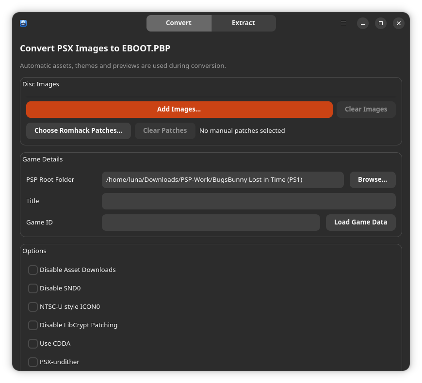
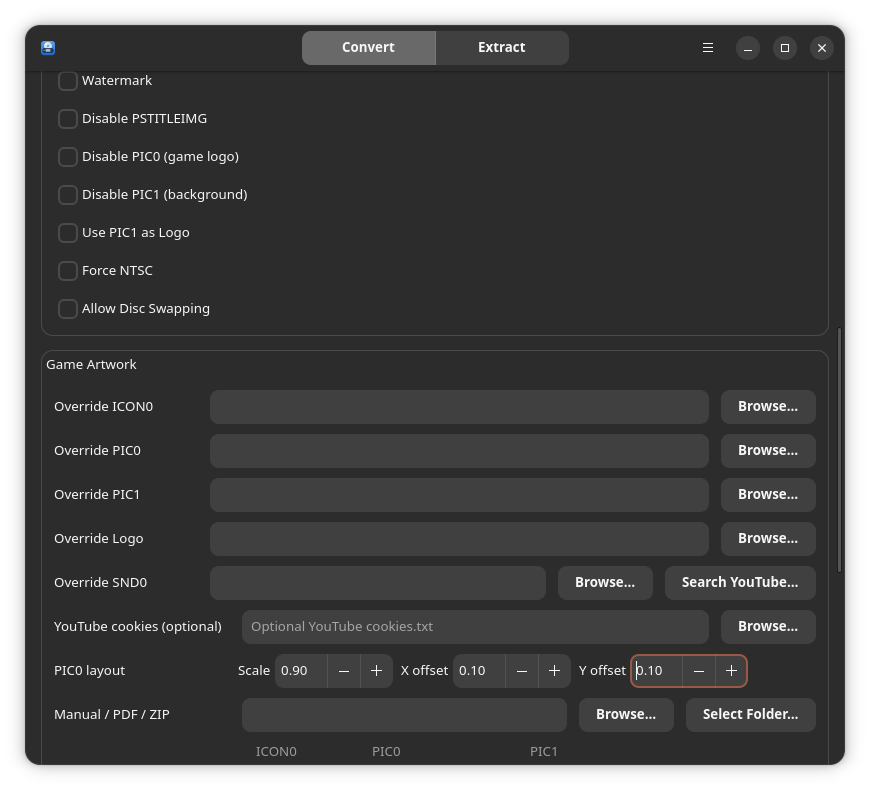
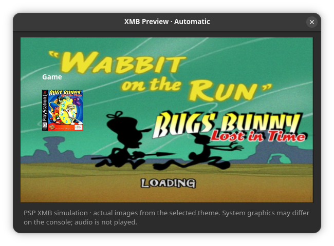
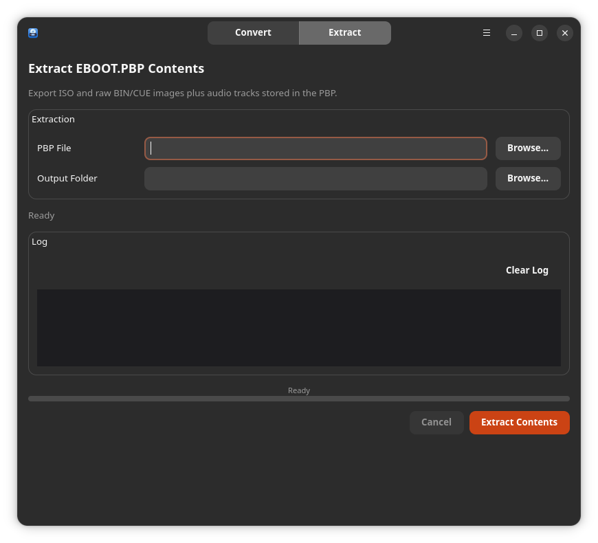

# POP-FE PSP Manager — User Guide

POP-FE PSP Manager is the GTK 4 desktop application in this repository. It converts PlayStation disc images to PSP `EBOOT.PBP` files and extracts supported disc content from a PBP. The original Python `pop-fe` tools are separate legacy programs; instructions for those scripts do not describe this GUI.

## Convert images to EBOOT.PBP

1. Open **Convert** and click **Add Images…**. Select one or more disc images. CUE, CCD, CHD, ISO, BIN, IMG, and ZIP archives containing a supported image are accepted. For multi-track discs, select the CUE or CCD descriptor so the track layout is preserved.
2. The application analyzes the first image and loads a detected game ID, title, database settings, compatibility patches, manual, and available artwork. Some assets may be downloaded. Additional images in a multi-disc set are analyzed as part of conversion; set or review their IDs in the disc list when needed.
3. Set **PSP Root Folder** to the root of the PSP storage (the folder containing `PSP/`). The output is created under `PSP/GAME/<game ID>/EBOOT.PBP`.
4. Review **Game Details**, **Options**, and **Game Artwork**. You can change the title or game ID, select a theme, provide artwork/manual overrides, or assign manual romhack patches (`.ppf` or `.xdelta`).
5. Click **Create EBOOT.PBP**. Progress and messages appear in the window; use **Cancel** to request cancellation.

The file chooser remembers the last folder used and falls back to your home folder if that location is no longer accessible.

### Update the game database

Use **Main Menu → Check for Database Updates…** to download and verify a database-only update. The application stores each update separately from its executable and activates it on the next launch. **Restore Previous Database** switches back to the prior verified version; restart the application afterward. Updates are optional, and the bundled database remains available offline. See [database update operations](DATABASE_UPDATES.md) for release and recovery details.

### Automatic metadata and artwork

When an image is analyzed, the built-in game database is used to identify it and select matching metadata and compatibility settings. Artwork and manuals are loaded when available. Theme artwork can be loaded for the selected theme, and **XMB Preview** opens a mock XMB screen using the real selected assets. The preview is illustrative; system graphics and playback can differ on a PSP.

If the disc is not recognized, enter a nine-character alphanumeric game ID and click **Load Game Data**. This can load database information for a known ID, but does not alter the disc image or guarantee that a missing compatibility fix exists.

### Multiple discs

Add the discs in the intended order. They are written into one PBP. Enable **Allow Disc Swapping** when the game needs to change discs during play. The game ID can be reviewed per disc. Disc swapping support depends on the game and PSP POPS firmware.

### Conversion options

| Option | Effect |
| --- | --- |
| Disable Asset Downloads | Avoid downloading missing game artwork or other remote assets. |
| Disable SND0 | Omit the optional XMB background audio. |
| NTSC-U style ICON0 | Use the NTSC-U-style game icon when available. |
| Disable LibCrypt Patching | Skip an automatic LibCrypt patch when one is available. |
| Use CDDA | Store CD audio as raw CDDA tracks instead of ATRAC3. This can increase output size. |
| PSX-undither | Apply the PSX-undither image processing option. |
| Watermark | Add the game title and ID watermark to PIC1 when that image is present. |
| Disable PSTITLEIMG | Omit the title image section. |
| Disable PIC0 / Disable PIC1 | Omit the corresponding XMB image. |
| Use PIC1 as Logo | Use PIC1 as the PBP logo image. |
| Force NTSC | Force NTSC video mode in the generated title data. |
| Allow Disc Swapping | Enable multi-disc swapping metadata in the PBP. |

The **PIC0 layout** controls adjust scale and X/Y position; the database can supply a per-game default. Artwork rows accept local overrides for ICON0, PIC0, PIC1, Logo, and SND0. A manual can be selected as a file or folder. The **Search YouTube…** action can find optional SND0 audio; network access may be denied by YouTube, in which case a browser-exported Netscape-format `cookies.txt` can be selected in the optional cookies field. `yt-dlp` and its JavaScript runtime are bundled with packaged builds; a source build needs the tools described in the packaging guide.

## Extract a PBP

1. Open **Extract**.
2. Select the `.PBP` file and an output folder.
3. Click **Extract Contents** and follow the progress in the window. Extraction can be cancelled.

The application exports raw disc data as BIN/CUE and exports audio tracks when present. It also writes an ISO when the data track can be represented as a 2048-byte-per-sector image. Some layouts cannot be represented as ISO; in that case, the raw BIN/CUE is retained. Multi-disc PBPs produce separate numbered disc files.

## Where settings are stored

The last file-dialog folder and conversion preferences are saved in the platform configuration directory:

- Linux: `~/.config/org.popfe.PSPManager/`
- macOS: `~/Library/Application Support/org.popfe.PSPManager/`
- Windows: `%APPDATA%/org.popfe.PSPManager/`

Temporary and cached disc files use the platform cache directory.

## Troubleshooting

- **Unknown game ID:** confirm the image and its companion CUE/CCD files are complete. You can enter a known nine-character ID and choose **Load Game Data**. If the game is absent from the embedded database, automatic metadata and fixes may not be available.
- **CHD conversion fails:** CHD support requires `chdman` from MAME tools. Linux source builds need it available on `PATH`; the Windows portable package does not include it, so install MAME and put `chdman.exe` and its adjacent DLLs on `PATH` or beside the application as described in the packaging guide.
- **YouTube SND0 download fails with HTTP 403:** provide a valid Netscape-format browser cookies file. YouTube can still reject downloads; this service is external to the application.
- **Images or manuals are missing:** check network access and ensure automatic asset downloads are enabled. You can supply local artwork or a manual override.
- **Conversion or extraction appears idle:** check the progress bar and log panel. Large images, artwork retrieval, and audio encoding can take time; the operation runs separately from the GTK interface and supports cancellation.

## Screenshots

These screenshots show the current Rust application with its English interface.

### Convert

The **Convert** tab accepts disc images and provides game details, conversion options, and the EBOOT creation action.

### Artwork and audio options

The lower part of the conversion page contains artwork overrides, optional YouTube audio search, manual selection, and the theme preview control.

### XMB theme preview

The preview uses the actual images loaded for the selected theme and game.

### Extract

The **Extract** tab selects a PBP and destination folder, then reports extraction status and progress.

